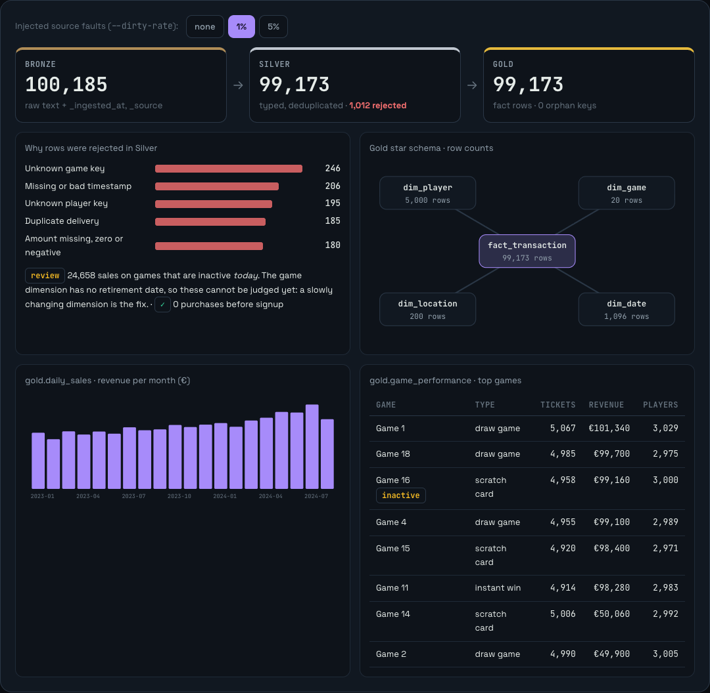

# Fabric Lottery Data Platform

<!-- showcase:start -->
> **[▶ Live showcase](https://phlppgdfry.github.io/fabric-lottery-data-platform/)** — inspect real pipeline runs at 0%, 1% and 5% injected faults: rejects with reasons, the Gold star schema and reporting tables. Runs on DuckDB today; Fabric is next.

[](https://phlppgdfry.github.io/fabric-lottery-data-platform/)
<!-- showcase:end -->

> **Nederlands leren met deze repo:** [Start de leergids](docs/leren/README.md) — code stap voor stap, vaardigheden, oefeningen met antwoorden, herhaalkaarten en je eigen leerlogboek.
> **Huidige status:** generator, SQL-ontwerp en een lokale Bronze → Silver → Gold-pipeline op DuckDB met tests en CI zijn aanwezig. Fabric-pipelines, PySpark-notebooks, Power BI en dbt zijn nog niet geïmplementeerd. De architectuur hieronder beschrijft mede het beoogde eindbeeld.

An end-to-end data engineering platform built on Microsoft Fabric, demonstrating:

- Microsoft Fabric (OneLake, Lakehouse, Pipelines, Notebooks)
- Medallion Architecture (Bronze / Silver / Gold)
- PySpark transformations
- SQL & data modelling (star schema)
- dbt (staging → intermediate → marts)
- Fabric Pipelines & orchestration
- Semantic Models & Power BI
- CI/CD (Git integration, deployment pipelines)
- Data quality testing
- Monitoring & production engineering

This project uses **synthetic lottery-style data** (players, games, tickets,
transactions, draws, retail locations, campaigns) — no real personal or
financial data — to build a realistic enterprise-grade data platform end to
end.

## Architecture

```
Source (synthetic events / CSV / API)
              |
        Fabric Pipelines
              |
        BRONZE Lakehouse
           raw data
              |
       PySpark notebooks
              |
        SILVER Lakehouse
      cleaned + validated
              |
          dbt / SQL
              |
          GOLD layer
       business-ready
              |
       Semantic Model
              |
          Power BI
```

Cross-cutting: Git, CI/CD, automated tests, data quality checks, monitoring,
logging, and documented architecture decisions.

## Repository layout

```
architecture/      diagrams and architecture decision records
data-generator/     synthetic data generation (players, games, transactions...)
notebooks/          PySpark notebooks: bronze ingestion, silver transform, gold aggregation
sql/                DDL and reference queries for the data model
dbt/                staging / intermediate / marts models + tests
pipelines/           Fabric pipeline definitions and orchestration notes
local/              Bronze -> Silver -> Gold on DuckDB (runs today, no Fabric needed)
tests/              end-to-end and data quality tests for generator + local pipeline
powerbi/            semantic model notes / exports
ci-cd/              CI/CD pipeline definitions (GitHub Actions / Azure DevOps)
docs/               data-model, medallion architecture, performance, monitoring, security
```

## Run it locally (no Fabric workspace needed)

```bash
python3 -m venv .venv && source .venv/bin/activate
pip install -r requirements-dev.txt

# synthetic data with 1% injected source faults (duplicates, bad amounts, unknown keys, bad timestamps)
python data-generator/generate_data.py --dirty-rate 0.01

# Bronze -> Silver -> Gold on DuckDB, with a JSON summary
python local/pipeline.py --db local/lottery.duckdb --summary local/summary.json
pytest -q tests
```

On the default 100,000 transactions with `--dirty-rate 0.01`: 100,185 Bronze rows become
99,173 Silver rows and 1,012 rejects, each with a reason; every Gold fact key resolves to a
dimension. The same seed always produces the same files.

## Status

| Part | State |
| --- | --- |
| Synthetic generator (seeded, optional fault injection) | done |
| Star schema DDL and reference queries | done |
| Local Bronze/Silver/Gold on DuckDB, quality rules, tests, CI | done |
| Fabric Lakehouse, PySpark notebooks, Fabric pipelines | not started (waiting for a Fabric workspace) |
| dbt models, Power BI semantic model, deployment pipelines | not started |

Showcase: <https://phlppgdfry.github.io/fabric-lottery-data-platform/>

## Why this project exists

Built as a hands-on portfolio project to develop and demonstrate Microsoft
Fabric / Azure data engineering skills: Medallion architecture, distributed
processing with PySpark, data modelling, DataOps, and production-grade
practices (CI/CD, testing, monitoring, security).
