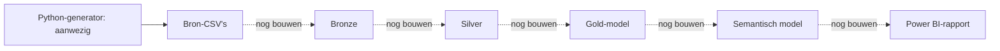

# Wat er nu staat en hoe je naar een volledig dataproduct groeit

[Leerroute](README.md) · [Oefeningen](oefeningen.md)

## 1. Zakelijke vraag en huidige grens

“Hoeveel wordt er per dag, spel en verkoopkanaal uitgegeven?” De bron is
synthetische lottery-achtige data. We bouwen begrip van data engineering;
we onderzoeken geen echte spelers en doen geen uitspraken over echt speelgedrag.

De bestaande code kan bron-CSV's genereren. SQL-bestanden beschrijven tabellen
en queries. Er bestaat nog geen complete laadroute die dat geheel automatisch
in Fabric realiseert.

## 2. Lees de generator

[generate_data.py](../../data-generator/generate_data.py) maakt eerst games,
winkellocaties en spelers, daarna transacties die naar die lijsten verwijzen.
`write_csv()` schrijft iedere verzameling naar een afzonderlijk CSV-bestand.

Een transactie bevat onder meer ID, speler, spel, eventueel locatie, kanaal,
bedrag en tijdstip. Het bedrag wordt op het generatiemoment uit de gekozen
spelprijs overgenomen. Alleen retailtransacties krijgen een winkellocatie;
bij online/mobile staat in de CSV een lege waarde.

De generator heeft een seed voor `random`, maar gebruikt ook `uuid.uuid4()`.
Dezelfde seed betekent dus **niet dat alle bytes, waaronder transactie-ID's,
bij twee runs identiek zijn**. Herhaalbaarheid is specifieker dan “er is een seed”.

Er zijn ook zakelijke randgevallen om te onderzoeken: spelers kunnen een
inschrijfdatum na hun gegenereerde transactie hebben en inactieve spellen kunnen
worden gekozen. Als je nul rijen laat genereren, verwacht `write_csv()` toch
`rows[0]`. De leermap lost dat niet op; het zijn concrete analyseopdrachten.

## 3. Volg één transactie naar het ontwerp

Voorbeeld: speler 7 koopt op 11 oktober 2024 via retail voor €5 een ticket voor
spel 3 in locatie 12. Het bedoelde feit krijgt speler 7, spel 3, locatie 12,
datum-ID 20241011, bedrag 5 en een uniek transactie-ID.

In de bestaande generator ontbreekt `date_id`. Een toekomstige transformatie
moet dat uit `transaction_ts` afleiden en tegen `dim_date` controleren. Dat is
precies het soort verbindingsstap dat een architectuurplaatje gemakkelijk verbergt.

## 4. Het stermodel begrijpen

Lees [01_dimensions.sql](../../sql/ddl/01_dimensions.sql) en
[03_fact_transaction.sql](../../sql/ddl/03_fact_transaction.sql).

| Tabel | Grain / betekenis van één rij | Belangrijke keuze |
|---|---|---|
| `fact_transaction` | Eén ticketaankoop/transactie | Bedrag hoort bij het moment van aankoop |
| `dim_player` | Eén huidige spelerbeschrijving | Nog geen historische versies |
| `dim_game` | Eén huidige spelbeschrijving | Actuele prijs kan later veranderen |
| `dim_location` | Eén retailplek | Online aankoop heeft geen verplichte locatie |
| `dim_date` | Eén kalenderdag | Datumcontext komt uit een gegenereerde kalender |

Waarom bedrag in de fact? Als de actuele spelprijs van €5 naar €6 verandert,
blijft de oude aankoop €5. Opnieuw historische omzet berekenen met de huidige
dimensieprijs zou geschiedenis herschrijven.

Hetzelfde geldt niet automatisch voor beschrijvende context. Verandert een
spelerkenmerk en wil je rapporteren naar het kenmerk **ten tijde van aankoop**,
dan heb je een historische ontwerpkeuze nodig, bijvoorbeeld SCD type 2 met
versies en tijdige koppeling. Die is hier niet gebouwd.

## 5. Het SQL-dialect is nog een stap

[02_populate_dim_date.sql](../../sql/ddl/02_populate_dim_date.sql) gebruikt
PostgreSQL-stijlconstructies zoals `GENERATE_SERIES`, `TO_CHAR` en `::INT`.
De feit-DDL gebruikt `UUID`. Behandel deze scripts als lokaal relationeel
leermateriaal; ze zijn geen kant-en-klare, geteste Fabric Warehouse-deployment.
Bij verdere bouw kies je expliciet Spark SQL/Lakehouse of Warehouse/T-SQL en
controleer je types, ondersteunde syntax en constraintgedrag voor dat doel.

De datumkalender loopt nu van 2023 tot en met 2025. Nieuwe bronperiodes moeten
dus tegen die dekking worden gecontroleerd. Een aanwezige datumtabel garandeert
niet dat iedere toekomstige transactiedatum erin zit.

## 6. De voorbeeldqueries kritisch lezen

[player_activity.sql](../../sql/queries/player_activity.sql) toont:

- `GROUP BY` en `HAVING`: één resultaat per speler met meer dan vijf transacties.
- Window functions: detailrijen blijven behouden, met volgnummer en spelertotaal.
- Een deduplicatiepatroon: kies één rij per transactie-ID.

De comment bij de window-query noemt “running spend”, maar `SUM(amount) OVER
(PARTITION BY player_id)` berekent het **totaal per speler op iedere detailrij**.
Een cumulatief totaal vraagt ook een geordend venster. Bij gelijke tijden is een
extra unieke sorteersleutel nodig voor voorspelbare volgorde.

De uiteindelijke fact heeft een primary key. Duplicaten op transactie-ID zouden
in een database met die constraint niet in die tabel horen te staan. Het
deduplicatiepatroon is vooral betekenisvol op een ruwe/staginglaag vóór de fact.

## 7. Fabric-lagen in gewone taal

Volgens Microsoft beschrijven Bronze, Silver en Gold verfijningsstappen:

| Laag | Doel | Oefening voor dit project |
|---|---|---|
| Bronze | Ruwe herkomst behouden | Bewaar CSV-inhoud plus bron, batch en ophaaltijd |
| Silver | Getypeerde, consistente en gecontroleerde data | Parse datums, behandel lege locaties en conflicten |
| Gold | Zakelijk bruikbare modellen | Facts/dimensies of omzet per dag en spel |

Gold hoeft niet uitsluitend uit geaggregeerde tabellen te bestaan. Ook zorgvuldig
gemodelleerde detailfacts kunnen zakelijk bruikbaar zijn. Definieer kwaliteits-
en toegangsafspraken per laag. Zie de geraadpleegde
[Microsoft-architectuurgids](https://learn.microsoft.com/en-us/fabric/onelake/architecture-patterns).

OneLake is de gedeelde opslagbasis binnen Fabric. Een Lakehouse combineert
bestanden en tabellen voor analytische verwerking. Een notebook bevat code en
uitvoer; een pipeline regelt uitvoering en afhankelijkheden. Dit zijn verschillende
verantwoordelijkheden, geen onderling verwisselbare namen voor een map.

## 8. Bouwopdrachten met acceptatiebewijs

De volgende stappen zijn **nog te doen**. Ze zijn geen claim over een bestaande
cloudomgeving. Werk in een oefenworkspace en houd uitsluitend synthetische data aan.
Gebruik actuele platformdocumentatie bij de uitvoering; menu's, capaciteit en
beschikbare functies kunnen wijzigen.

### Stap A — Bron begrijpen

Begin met een kleine generatorset. Bekijk iedere CSV en noteer sleutels, types,
rijaantallen en tijdsbereik. Zoek een retail- en online-transactie.
**Klaar wanneer:** je één transactie met alle verwijzingen handmatig kunt volgen
en minstens één generatorbeperking hebt beschreven.

### Stap B — Bronze maken

Bewaar een bronbatch met herkenbare batch-ID en bronmetadata. Ontwerp hoe je
dezelfde input terugvindt zonder stilzwijgend een andere dataset te genereren.
**Klaar wanneer:** je bronrijtelling en bronbestand kunt aanwijzen, en opnieuw
verwerken kunt starten vanaf diezelfde bewaarde input.

### Stap C — Silver maken

Definieer types, lege locatie voor online, transactiesleutel, datum-ID en
kwaliteitsregels. Scheid afgekeurde regels met een reden. Beslis hoe je een
transactie vóór inschrijving behandelt.
**Klaar wanneer:** bron = geaccepteerd + afgekeurd + verklaarde duplicaten,
en een bewust ongeldige rij aantoonbaar wordt behandeld.

### Stap D — Gold en zakelijke afspraken

Maak facts/dimensies en een omzetberekening. Controleer ontbrekende dimensies,
unieke sleutels en bedragen. Bepaal of “omzet” ticketverkopen betekent en hoe
annuleringen/terugbetalingen zouden worden behandeld.
**Klaar wanneer:** een klein handmatig voorbeeld en SQL/modeltotalen overeenkomen,
ook na filteren op dag, spel en kanaal.

### Stap E — Semantisch model en Power BI

Maak expliciet een semantisch model met de gewenste tabellen. Leg relaties vast,
voeg measures toe en geef zakelijke namen. Microsoft beschrijft dat modelcreatie
vanuit Lakehouse, Warehouse of SQL analytics endpoint kan starten; relaties en
measures worden daarna verder ingericht.
[Bron: semantisch model maken](https://learn.microsoft.com/en-us/fabric/data-warehouse/create-semantic-model).

Oefen met omzet, aantal transacties en gemiddelde transactiewaarde. Een measure
wordt binnen een selectie berekend; een vast opgeslagen rijbedrag heeft een
andere rol. Vergelijk een kaart met een onafhankelijke SQL-berekening en herhaal
na datum- en kanaalfilters. Leer vervolgens DAX en Power Query praktisch;
deze repo bevat daar nu geen uitgewerkte implementatie van.

**Klaar wanneer:** relaties geen dubbeltelling veroorzaken, filters verklaarbaar
werken en de drie KPI's met een klein controlevoorbeeld kloppen. Bewaar model- en
rapportbestanden waar export mogelijk is, plus een korte demo en controletotalen.
Een screenshot alleen bewijst geen juist datamodel.

### Stap F — Betrouwbaar uitvoeren en beheren

Voeg volgorde, foutafhandeling en runmetadata toe. Herhaal dezelfde input en
controleer dat het resultaat niet onbedoeld verdubbelt. Test een ontbrekend
bronveld en leg vast welke stap stopt. Meet runtime en rijaantallen.

Definieer eigenaar, toegangsrollen en dataretentie. Voor RLS moeten rollen bestaan
voordat je hun beveiliging beheert; test toegestane en verboden rijen met de
bedoelde gebruikerscontext.
[Bron: RLS beheren](https://learn.microsoft.com/en-us/fabric/security/service-admin-row-level-security).

**Klaar wanneer:** je een geslaagde run, gecontroleerd foutpad, herstart en
toegangscontrole kunt aantonen. Voeg pas daarna een deploymentroute toe met
afzonderlijke ontwikkel- en doelomgeving. Gitbestanden alleen vormen nog geen CI/CD.

## 9. Wat je bij een gesprek kunt zeggen

Nu: “Ik bestudeer een synthetisch datamodel met een Python-generator en SQL.
Ik kan de grain en keuze voor historische bedragen uitleggen. De Fabric- en
Power BI-route moet ik nog implementeren en aantoonbaar testen.”

Later voeg je alleen uitgevoerde stappen toe, met bewijs uit het leerlogboek.
Geen vaste kalender maakt je automatisch klaar voor een zelfstandige engineerrol;
de gecontroleerde uitvoering en je eigen redenering zijn het bewijs.
